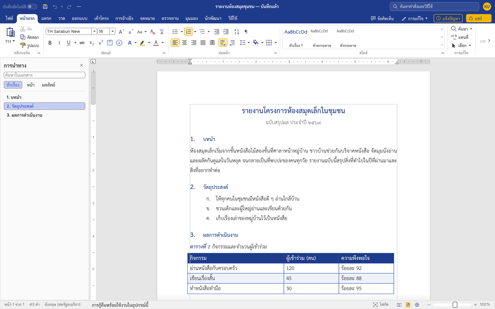
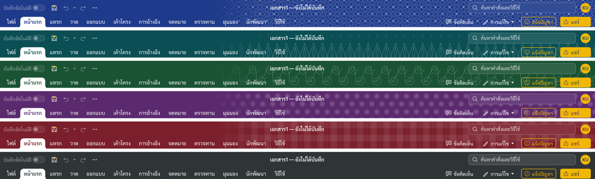
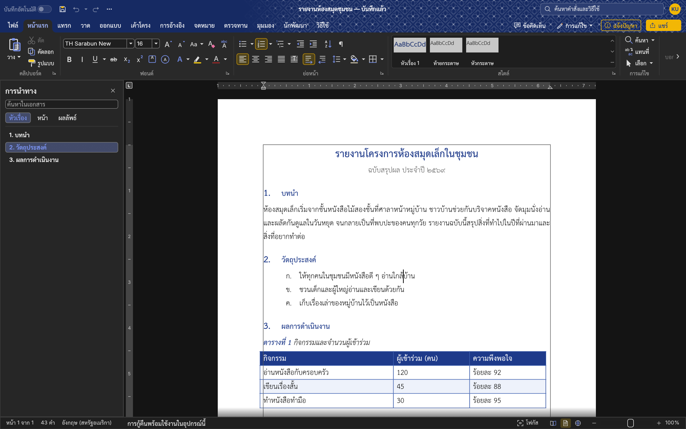
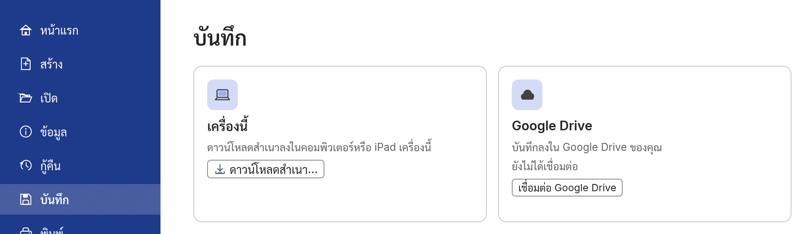
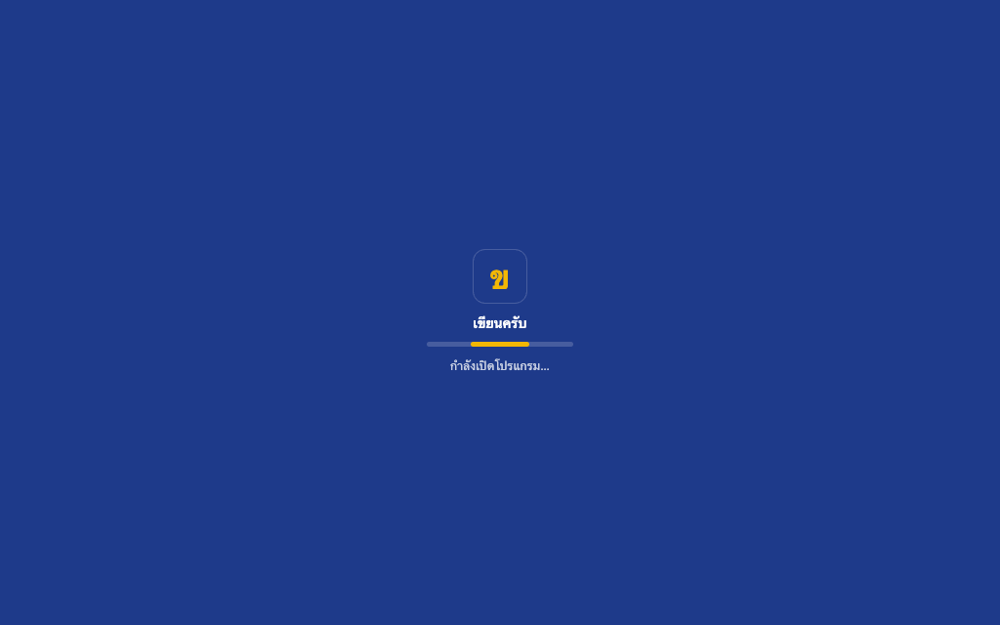
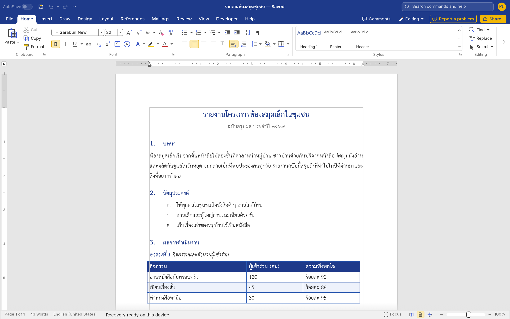
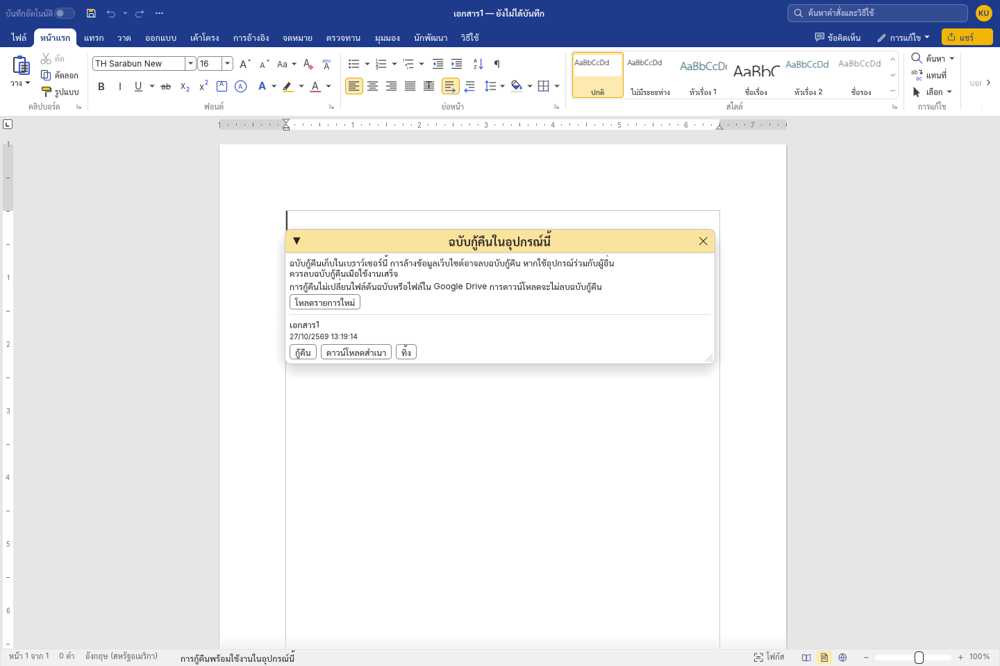

[เกี่ยวกับ / About](https://khiankrub.app/about.html) · [นโยบายความเป็นส่วนตัว / Privacy Policy](https://khiankrub.app/privacy.html)

  

# เขียนครับ · KhianKrub Web v0.9.1

**โปรแกรมพิมพ์เอกสารภาษาไทยและภาษาอังกฤษ ใช้งานฟรีบนเว็บ**

**A free browser-based word processor for Thai and English.**

**[เปิดใช้งาน / Open KhianKrub](https://khiankrub.app/)** · ปุ่ม **แจ้งปัญหา** ในโปรแกรม / the **Report a problem** button in the app

  

## ประกาศเปิดตัวภาษาไทย

ขอแนะนำ **เขียนครับบนเว็บ (KhianKrub Web) v0.9.1** โปรแกรมพิมพ์เอกสารภาษาไทยและภาษาอังกฤษที่ใช้ได้ฟรีผ่านเบราว์เซอร์ เปิดใช้งานได้ที่ **[khiankrub.app](https://khiankrub.app/)** โดยไม่ต้องดาวน์โหลดตัวติดตั้ง

รุ่นเว็บเริ่มต้นด้วยเอกสารเปล่า ใช้ TH Sarabun New ขนาด 16 จุด มีเมนูภาษาไทยและภาษาอังกฤษ เครื่องมือจัดรูปแบบข้อความ ย่อหน้า รายการ ตาราง และรูปภาพ เปิด แก้ไข และบันทึกไฟล์ Word (`.docx`) รวมถึงส่งออกเป็น PDF ได้ ผู้ใช้ Chrome สามารถติดตั้งให้เปิดเป็นหน้าต่างแอปแยกได้ด้วย

เหมาะสำหรับใช้งานบนคอมพิวเตอร์และ iPad ยังไม่รองรับโทรศัพท์มือถือ และยังต้องเชื่อมต่ออินเทอร์เน็ต มีฉบับกู้คืนอัตโนมัติที่เก็บในเบราว์เซอร์บนอุปกรณ์เดิม เพื่อช่วยกู้คืนงานหลังปิดหน้าโดยไม่ตั้งใจ แต่ยังควรบันทึกไฟล์สำเนาไว้ด้วย

เป็นโครงการเล็ก ๆ ที่ยังอยู่ระหว่างพัฒนา หากพบปัญหาหรือมีข้อเสนอแนะ รบกวนกดปุ่ม **แจ้งปัญหา** ข้างปุ่มแชร์ในโปรแกรม ขอบคุณทุกคนที่ช่วยทดลองใช้และแนะนำครับ

พัฒนาต่อยอดจาก [WordCraft](https://github.com/storytold/wordcraft) โดยทีม ArtCraft ปรับปรุงสำหรับผู้ใช้ภาษาไทยโดย Chanon Sarasuk

## English launch announcement

Introducing **KhianKrub Web v0.9.1**, a free word processor for Thai and English that runs in your browser. Try it at **[khiankrub.app](https://khiankrub.app/)** without downloading an installer.

The web app opens a blank document in TH Sarabun New, 16 pt, with Thai and English menus. It includes text and paragraph formatting, lists, tables and pictures; opens, edits and saves Word documents (`.docx`); and exports PDF. Chrome users can also install it to open in a separate app window.

KhianKrub Web is intended for computers and iPads. Phones are not supported, and an internet connection is still required. Automatic recovery drafts stay in this browser on this device and can help restore interrupted work. Please also save a separate file copy.

This is a small project that is still developing. If you find a problem or have a suggestion, please press **Report a problem** (แจ้งปัญหา) next to Share in the app. Thank you for trying it and helping improve it.

Based on [WordCraft](https://github.com/storytold/wordcraft) by the ArtCraft team, adapted for Thai users by Chanon Sarasuk.

## หน้าตาโปรแกรม / A look around

### สีแถบด้านบนและลวดลายไทย / Band colours and Thai motifs

เลือกสีแถบด้านบนได้หกสี และใส่ลวดลายไทยจาง ๆ ได้ ทั้งประจำยาม กระจัง ก้านขด ดอกพิกุล และผ้าขาวม้า ที่ **ไฟล์ → ตัวเลือก → ทั่วไป** ลวดลายทุกแบบวาดขึ้นใหม่โดยโปรแกรมเอง

Six band colours, each with an optional faint Thai motif: ประจำยาม, กระจัง, ก้านขด, ดอกพิกุล or ผ้าขาวม้า. Choose them under **File → Options → General**. Every motif is drawn by KhianKrub itself.

  

<table>
<tr>
<td width="60%" valign="top">
<b>ธีมมืด / Dark theme.</b> เมนูและแถบเครื่องมือเป็นสีเข้ม หน้ากระดาษยังขาวเหมือนตอนพิมพ์ / Dark menus and ribbon, with the page kept white as it will print.
</td>
<td width="40%" valign="top">
<b>บันทึก / Save.</b> ดาวน์โหลดลงเครื่อง หรือบันทึกลง Google Drive ในหน้าเดียว / Download a copy, or save to Google Drive, from one page.

<b>หน้ารอเปิดโปรแกรม / Loading screen</b> ครั้งแรกอาจใช้เวลาสักครู่ / The first visit takes a moment.
</td>
</tr>
</table>

### เมนูภาษาอังกฤษ / English menus

### แจ้งปัญหา / Report a problem

ปุ่ม **แจ้งปัญหา** สีทองข้างปุ่มแชร์ เปิดแบบฟอร์มสั้น ๆ ให้เล่าว่าเกิดอะไรขึ้น โปรแกรมใส่รุ่นและชื่อเบราว์เซอร์ให้เอง ไม่มีการส่งเนื้อหาเอกสาร

The gold **Report a problem** button beside Share opens a short form. The app fills in its version and your browser; no document content is sent.

## ความสามารถ / Features

| ภาษาไทย | English |
|---|---|
| เปิด แก้ไข และบันทึกไฟล์ Word (`.docx`) พร้อมส่งออก PDF | Open, edit and save Word documents (`.docx`), and export PDF |
| เอกสารใหม่ใช้ TH Sarabun New 16 จุด พร้อมฟอนต์แห่งชาติ SIPA ครบ 13 ตระกูล ไม่ต้องติดตั้งเพิ่ม | New documents use TH Sarabun New, 16 pt; all 13 original SIPA national-font families are included, with no installation needed |
| ตัดคำไทย จัดข้อความแบบกระจายไทย และใช้เลขหรือตัวอักษรไทยในรายการ | Thai word breaking, Thai Distribution, and Thai list numbering |
| จัดรูปแบบข้อความ ย่อหน้า สไตล์ หัวเรื่อง ตาราง และรูปภาพ | Format text, paragraphs, styles, headings, tables and pictures |
| เมนูหลักภาษาไทยและภาษาอังกฤษ บางกล่องโต้ตอบยังเป็นภาษาอังกฤษ | Thai and English interface options; some dialogs remain in English |
| เลือกธีม สีแถบด้านบน ลวดลายไทย ขนาดเมนู และหน่วยวัด | Choose the theme, band colour, Thai motif, interface size and measurement units |
| เก็บภาษา หน่วยวัด ธีม และการตั้งค่าเมนูในเบราว์เซอร์เดิมบนอุปกรณ์เดิม | Remember language, units, theme and interface preferences in the same browser on the same device |
| มีฉบับกู้คืนอัตโนมัติในเบราว์เซอร์ พร้อมกู้คืน ดาวน์โหลด และทิ้งฉบับกู้คืน | Automatic recovery drafts in the browser, with restore, download and discard controls |
| ติดตั้งผ่าน Chrome เพื่อเปิดในหน้าต่างแอปแยก | Install through Chrome to open in a separate app window |

## การกู้คืนงาน / Recovery drafts

เปิดการกู้คืนไว้โดยเริ่มต้น โปรแกรมจะเก็บฉบับกู้คืนในเบราว์เซอร์หลังหยุดพิมพ์ประมาณ 2 วินาที หรือเป็นระยะระหว่างพิมพ์ต่อเนื่อง เมื่อเปิดเว็บอีกครั้ง ให้เลือก **จัดการฉบับกู้คืน** เพื่อกู้คืน ดาวน์โหลดสำเนา หรือทิ้งฉบับที่ไม่ต้องการ ตั้งค่าได้ที่ **ไฟล์ → ตัวเลือก → ทั่วไป → การกู้คืนในอุปกรณ์นี้**

Recovery is on by default. A snapshot is saved after about two seconds without changes, or periodically during continuous editing. On return, use **Manage recovery drafts** to restore, download a copy, or discard a draft. Configure it under **File → Options → General → Recovery on this device**.

- สถานะ **บันทึกฉบับกู้คืนในอุปกรณ์นี้แล้ว** หมายถึงฉบับกู้คืนในเบราว์เซอร์ ไม่ใช่ไฟล์ต้นฉบับหรือ Drive / **Recovery copy saved on this device** refers to a browser draft, not the original file or Drive.
- เก็บฉบับก่อนหน้าไว้ด้วย การดาวน์โหลดไม่ลบฉบับกู้คืน / The previous snapshot is also kept. Downloads do not delete drafts.
- กู้คืนเนื้อหาและรูปแบบของเอกสาร โดยไม่กู้คืนประวัติเลิกทำ / Restoration keeps document content and formatting, but does not restore undo history.
- หากใช้อุปกรณ์ร่วมกับผู้อื่น ควรทิ้งฉบับกู้คืนเมื่อเสร็จงาน / On shared devices, discard recovery drafts when finished.

## เริ่มใช้งาน / Getting started

1. เปิด / Visit **[khiankrub.app](https://khiankrub.app/)** บนคอมพิวเตอร์หรือ iPad / on a computer or iPad.
2. เริ่มพิมพ์ในเอกสารเปล่า หรือเลือก **ไฟล์ → เปิด** / Start typing, or choose **File → Open**.
3. บันทึกงานผ่าน **ไฟล์ → บันทึก** ลงเครื่องหรือ Google Drive / Save your work through **File → Save**, to this device or Google Drive.
4. หากต้องการติดตั้ง กดไอคอนติดตั้งในแถบที่อยู่ของ Chrome (ถ้ามี) หรือเลือกคำสั่งติดตั้งแอปจากเมนู Chrome แล้วยืนยัน / To install, click Chrome's address-bar install icon, if shown, or use its app-install menu option and confirm.

## ข้อจำกัดที่ควรทราบ / Current limits

- **รองรับคอมพิวเตอร์และ iPad ไม่รองรับโทรศัพท์มือถือ** / **Computers and iPads are supported; phones are blocked.**
- ต้องใช้อินเทอร์เน็ต แม้ติดตั้งเป็นแอปแล้ว / Internet is required, including when installed.
- ฉบับกู้คืนอยู่เฉพาะในเบราว์เซอร์และอุปกรณ์เดิม การล้างข้อมูลเว็บไซต์ โหมดส่วนตัว หรือความเสียหายของอุปกรณ์อาจทำให้ฉบับกู้คืนหายไป ควรบันทึกไฟล์สำเนาไว้ด้วย / Recovery stays in the same browser and device. Clearing site data, private browsing, or device failure can remove it; keep a saved file copy too.
- เอกสารที่มีรหัสผ่านไม่ถูกเก็บเป็นฉบับกู้คืนอัตโนมัติ เอกสารใหญ่หรือพื้นที่เต็มอาจบันทึกฉบับกู้คืนไม่ได้ ให้ดูข้อความสถานะ / Password-protected documents are excluded from automatic recovery. Large documents or storage limits can prevent recovery saves; check the status message.
- เอกสาร Word ที่ซับซ้อนอาจแสดงต่างจากต้นฉบับ ควรตรวจรูปแบบก่อนนำไปใช้ / Complex Word documents may render differently; check important formatting.
- Google Drive ยังเป็นฟีเจอร์ทดลอง อาจจำกัดบัญชีที่เชื่อมต่อ บันทึกเป็นสำเนาใหม่ได้ไม่เกิน 5 MB และต้องเชื่อมต่อใหม่หลังโหลดหน้า / Google Drive is experimental and may be limited to configured test users. It saves new copies up to 5 MB and requires reconnection after a reload.
- ยังไม่เพิ่มการเชื่อมต่อ Google แบบค้างไว้หรือสิทธิ์เข้าถึง Drive ทั้งหมด / Persistent Google connection and whole-Drive access have not been added.

## ข้อมูลและความเป็นส่วนตัว / Data and privacy

เอกสารประมวลผลในเบราว์เซอร์ การตั้งค่า ฟอนต์ที่เพิ่มเอง และฉบับกู้คืนเก็บในเบราว์เซอร์ ไม่มีการส่งฉบับกู้คืนไปยังเซิร์ฟเวอร์ของ KhianKrub สามารถปิดการกู้คืนและทิ้งฉบับกู้คืนได้ การล้างข้อมูลเว็บไซต์อาจลบข้อมูลเหล่านี้ การตั้งค่าไม่ซิงก์ระหว่างอุปกรณ์ การเชื่อมต่อ Google Drive เกิดขึ้นเมื่อผู้ใช้เลือกเชื่อมต่อ และโทเคนอยู่ในหน่วยความจำของหน้านั้น เว็บนับจำนวนผู้เข้าชมด้วย Cloudflare Web Analytics ซึ่งไม่ใช้คุกกี้และไม่ส่งเนื้อหาเอกสาร

Documents are processed in the browser. Preferences, explicitly added fonts and recovery drafts are stored locally in the browser; clearing site data can remove them. Recovery drafts are not uploaded to KhianKrub servers. You can turn recovery off and discard drafts. Preferences do not sync between devices. Google Drive connects when requested, and its access token stays in page memory. Visits are counted with Cloudflare Web Analytics, which uses no cookies and sends no document content.

## โครงการและสิทธิ์การใช้งาน / Project and credits

คลังนี้เป็นเว็บที่ build แล้ว พร้อมภาพหน้าจอ เอกสาร และประกาศสิทธิ์ โค้ดต้นฉบับของรุ่นเว็บเก็บในคลังส่วนตัว

This public repository contains the built web app, screenshots, documentation and licence notices. The web app's source repository is private.

KhianKrub is based on [WordCraft](https://github.com/storytold/wordcraft) by the ArtCraft team, adapted by Chanon Sarasuk. It is not affiliated with or endorsed by the ArtCraft team. WordCraft's [MIT](LICENSE-MIT) and [Apache-2.0](LICENSE-APACHE) licences, [NOTICE](NOTICE), [asset attribution](ATTRIBUTION.md), and the font licences in `fonts/` accompany the built app. Screenshots show KhianKrub itself with original example text.

Prepared from version **0.9.1**, source commit `f1450a3d`.
