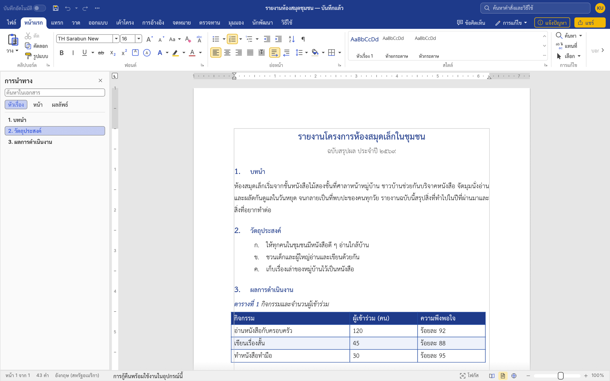
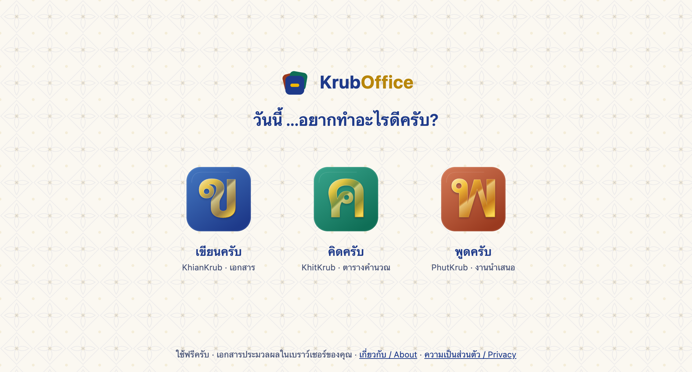
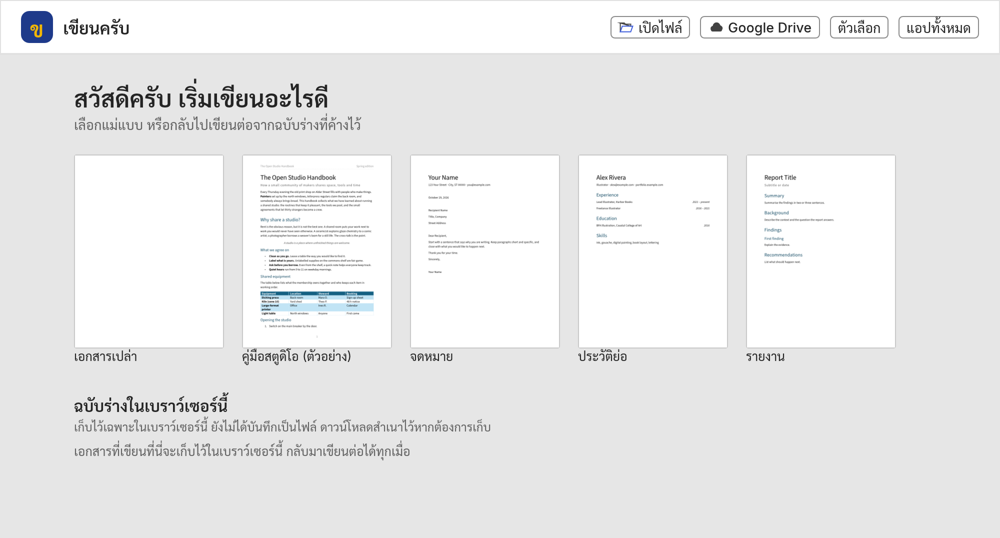
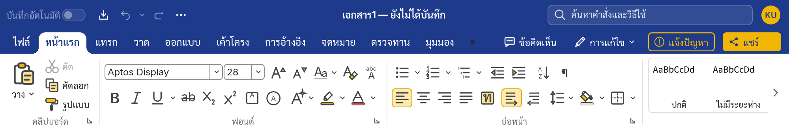
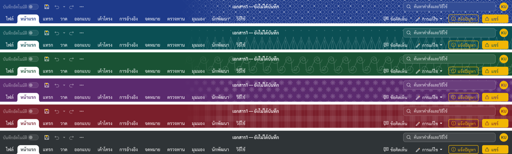
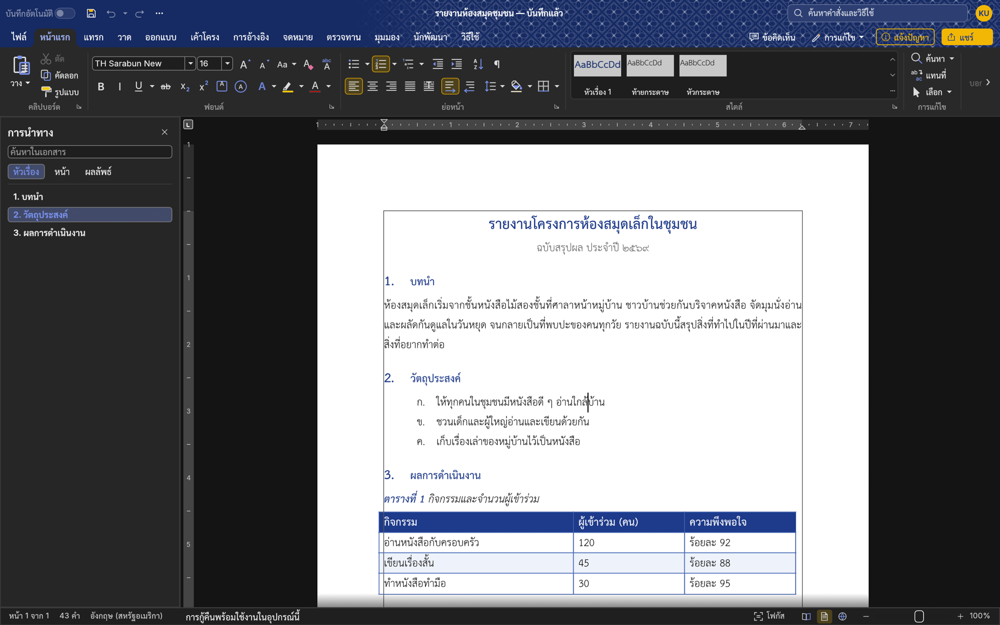
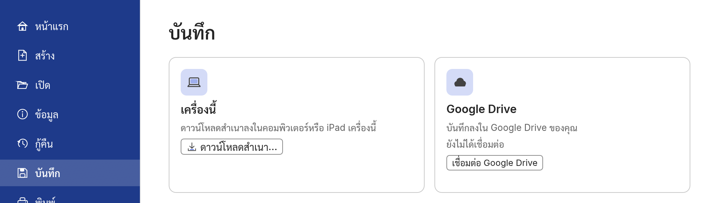
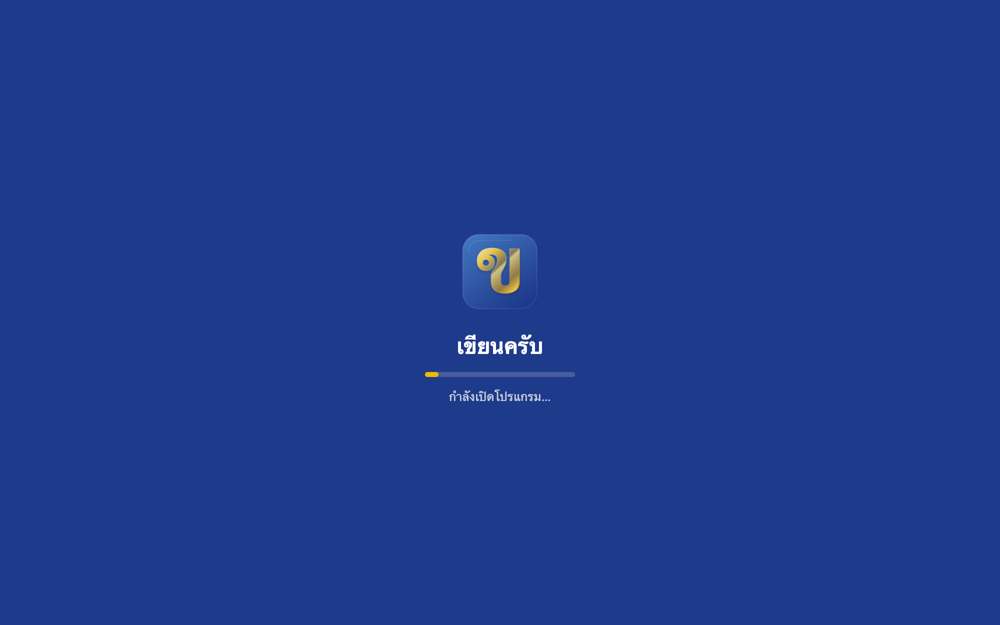
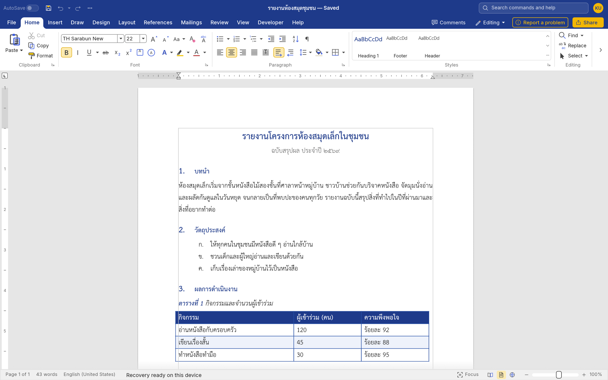

[เกี่ยวกับ / About](https://khiankrub.app/about.html) · [นโยบายความเป็นส่วนตัว / Privacy Policy](https://khiankrub.app/privacy.html)

  

# เขียนครับ · KhianKrub Web v0.12.0

**โปรแกรมพิมพ์เอกสารภาษาไทยและภาษาอังกฤษ ใช้งานฟรีบนเว็บ**

**A free browser-based word processor for Thai and English.**

**[เปิดใช้งาน / Open KhianKrub](https://khiankrub.app/)** · [KrubOffice](https://kruboffice.app/) · ปุ่ม **แจ้งปัญหา** ในโปรแกรม / the **Report a problem** button in the app

  

## ประกาศภาษาไทย

**เขียนครับบนเว็บ (KhianKrub Web) v0.12.0** คัดลอกและตัดตารางได้ กล่องโต้ตอบเป็นภาษาไทย และฉบับร่างที่ชัดเจนขึ้นครับ

- **ฉบับร่างในอุปกรณ์นี้** เอกสารใหม่ที่ยังไม่ได้บันทึกเป็นไฟล์หรือลง Google Drive เรียกว่าฉบับร่างอย่างชัดเจน หน้าเริ่มต้นแสดง **ชื่อ (ฉบับร่าง)** แถบชื่อด้านบนแสดง **(ฉบับร่าง) — บันทึกในอุปกรณ์นี้แล้ว** และเมื่อทุกอย่างถูกเก็บแล้ว ปิดแท็บได้โดยเบราว์เซอร์ไม่ถาม ส่วนไฟล์ที่เปิดจากเครื่องหรือ Google Drive ที่ยังมีการแก้ไขค้างอยู่ เบราว์เซอร์จะถามก่อนปิดแท็บ
- **กล่องโต้ตอบเป็นภาษาไทย** เมื่อเลือกเมนูภาษาไทย หน้าต่างถามบันทึกการเปลี่ยนแปลง ไฟล์ › ตัวเลือก และกล่องโต้ตอบที่ใช้บ่อย เช่น ฟอนต์ ย่อหน้า ตั้งค่าหน้ากระดาษ ค้นหาและแทนที่ และสัญลักษณ์ เป็นภาษาไทยแล้ว ส่วนกล่องโต้ตอบที่ใช้น้อยกว่าจะทยอยแปลต่อไป
- **คัดลอกและตัดตาราง** เลือกทั้งตารางแล้วตัด ตารางจะถูกนำออกทั้งตาราง เลือกแถวหรือเซลล์แล้วคัดลอก จะได้ตารางเฉพาะส่วนที่เลือกไปวางได้ ตัดแถวหรือเซลล์จะลบข้อความและคงแถวและเซลล์ไว้ เหมือนใน Word
- **ข้อความในรูปร่างหมุนตามรูปร่าง** หมุนกล่องข้อความหรือรูปร่าง ข้อความข้างในหมุนตามไปด้วย ระหว่างพิมพ์แก้ข้อความจะตั้งตรงให้อ่านง่าย
- **บันทึกเป็นแม่แบบ Word (.dotx)** ใน ไฟล์ › ส่งออก
- **เลขลำดับ a. b. c.** ในคลังลำดับเลขของแท็บหน้าแรก
- **ฟอนต์ Tahoma** เมื่อเปิดเอกสารที่ใช้ Tahoma โปรแกรมบอกวิธีโหลดฟอนต์จากเครื่อง (Chrome และ Edge โหลดฟอนต์ที่ติดตั้งในเครื่องได้ เบราว์เซอร์อื่นเพิ่มไฟล์ฟอนต์เองได้)
- **จัดหน้าเหมือน Word มากขึ้น** เลขลำดับหัวข้อนับถูกต้องเมื่อขึ้นต้นด้วยหัวข้อย่อย (เช่น ข้อ 10.1 แล้วต่อด้วยข้อ 11) จุดนำแท็บในสารบัญและแบบฟอร์มเว้นระยะเหมือน Word เส้นขอบด้านข้างของย่อหน้าอยู่นอกข้อความ และย่อหน้าที่ขึ้นส่วนแบบต่อเนื่องไม่ล้นหน้ากระดาษอีกต่อไป
- **ไฟล์ .doc** เปิดได้ถูกต้องขึ้น ไฟล์จาก Word 365 ใช้ฟอนต์ Aptos ตามต้นฉบับ ส่วนของเอกสารและเซลล์ตารางอ่านได้ถูกต้อง และทนต่อไฟล์เสียมากขึ้น
- **ไฟล์ .docx และ .rtf** ขนาดฟอนต์เริ่มต้นถูกเก็บเมื่อบันทึก ไฟล์ .docx ที่มีความสัมพันธ์จำนวนมากเปิดได้ทันทีแทนการรอหลายนาที และรูปภาพแบบ WMF และ EMF ในไฟล์ .rtf ไม่หายแล้ว
- **หัวกระดาษและท้ายกระดาษ** ปิดหัวกระดาษหรือท้ายกระดาษแล้ว เคอร์เซอร์กลับไปที่เดิมในเนื้อหา
- **การพิมพ์และอื่น ๆ** เอกสารที่มีลิงก์หรือสารบัญพิมพ์ได้ สารบัญแบบลิงก์ใช้เลขหน้าแบบ PAGEREF เหมือน Word ย่อหน้าที่ใช้สไตล์ที่ไม่มีอยู่จัดรูปแบบเป็นปกติ ขยาย/ย่อขนาดฟอนต์ทีละขั้นตามขนาดของแต่ละส่วน และคุณสมบัติตารางใช้กับทุกแถว คอลัมน์ และเซลล์ที่เลือก

ใช้ได้ฟรีบนคอมพิวเตอร์และ iPad ยังไม่รองรับโทรศัพท์มือถือ หากพบปัญหาหรือมีข้อเสนอแนะ รบกวนกดปุ่ม **แจ้งปัญหา** ข้างปุ่มแชร์ในโปรแกรม ขอบคุณทุกคนที่ช่วยทดลองใช้ครับ

พัฒนาต่อยอดจาก [WordCraft](https://github.com/storytold/wordcraft) โดยทีม ArtCraft ปรับปรุงสำหรับผู้ใช้ภาษาไทยโดย Chanon Sarasuk

## English announcement

**KhianKrub Web v0.12.0** copies and cuts tables, has its dialogs in Thai, and calls drafts plainly drafts.

- **Drafts on this device.** A new document not yet saved as a file or to Google Drive is plainly called a draft: the start screen lists **Name (draft)**, the title bar reads **(draft) — Saved on this device**, and once everything is kept the tab closes without the browser asking. A file opened from this device or Google Drive with unsaved edits still makes the browser ask before the tab closes.
- **Dialogs in Thai.** With Thai menus, the Save Changes prompt, File › Options and the most-used dialogs, such as Font, Paragraph, Page Setup, Find and Replace and Symbol, are in Thai; the less-used dialogs will follow.
- **Copy and cut tables.** Select a whole table and Cut removes it; copy rows or cells and you get a table of just those to paste; cutting rows or cells clears their text and keeps the rows and cells, as in Word.
- **Text turns with its shape.** Rotate a text box or shape and the text inside turns with it; while you edit, it stands upright so it's easy to read.
- **Save as a Word template (.dotx)** from File › Export.
- **a. b. c. numbering** in the Numbering library on the Home tab.
- **Tahoma.** When a document uses Tahoma, the app explains how to load the font from your computer (Chrome and Edge can use installed fonts; in other browsers you can add the font file).
- **Layout closer to Word.** List numbers count correctly when a sub-item comes first (10.1, then 11); tab leader dots in tables of contents and forms are spaced as in Word; paragraph side borders sit outside the text; and paragraphs that each start a continuous section no longer run off the page.
- **.doc files** open more faithfully: Word 365 files use Aptos as in the original, sections and table cells are read correctly, and damaged files are handled more safely.
- **.docx and .rtf files.** The default font size is kept when saving, a .docx with many relationships opens at once instead of after minutes, and WMF and EMF pictures in .rtf files are no longer lost.
- **Header and footer.** Closing the header or footer takes you back to where you were in the body.
- **Printing and more.** Documents with links or a table of contents print; linked tables of contents use PAGEREF page numbers as Word does; a paragraph with a missing style is formatted as Normal; Grow and Shrink Font step each part from its own size; and Table Properties applies to every selected row, column and cell.

It's free on computers and iPads; phones aren't supported yet. If you find a problem or have a suggestion, please press **Report a problem** (แจ้งปัญหา) next to Share in the app. Thank you for trying it.

Based on [WordCraft](https://github.com/storytold/wordcraft) by the ArtCraft team, adapted for Thai users by Chanon Sarasuk.

## หน้าตาโปรแกรม / A look around

### หน้าเริ่มต้นและ KrubOffice / The start screen and KrubOffice

**kruboffice.app** คือหน้ารวมโปรแกรมให้เลือกใช้ ตอนนี้เลือกใช้ได้ทั้งเขียนครับ คิดครับ และพูดครับ ส่วน **khiankrub.app** เปิดเขียนครับที่หน้าเริ่มต้นทันที เลือกแม่แบบ หรือเขียนต่อจากฉบับร่างในเบราว์เซอร์นี้

**kruboffice.app** is the home page where you pick an app; KhianKrub, KhitKrub and PhutKrub are all available. **khiankrub.app** opens KhianKrub straight on its start screen: pick a template, or carry on with a draft kept in this browser.

<table>
<tr>
<td width="50%" valign="top">
<b>KrubOffice</b> · kruboffice.app
</td>
<td width="50%" valign="top">
<b>หน้าเริ่มต้น / Start screen</b> · khiankrub.app
</td>
</tr>
</table>

### ไอคอนชุดใหม่ / The new icons

ไอคอนบนริบบิ้นวาดใหม่ทั้งชุด เส้นสีเข้มอ่านง่าย แต้มสีทองเฉพาะส่วนสำคัญ ใช้ชุดเดียวกันทั้งสามโปรแกรมใน KrubOffice ปุ่มกระจายแบบไทยในกลุ่มย่อหน้ามีไอคอนตัว ท

Every ribbon icon is redrawn: dark, easy-to-read lines with a touch of gold where it matters, shared by all three KrubOffice apps. The Thai Distribution button in the Paragraph group shows a ท.

  

### สีแถบด้านบนและลวดลายไทย / Band colours and Thai motifs

เลือกสีแถบด้านบนได้หกสี และใส่ลวดลายไทยจาง ๆ ได้ ทั้งประจำยาม กระจัง ก้านขด ดอกพิกุล และผ้าขาวม้า ที่ **ไฟล์ → ตัวเลือก → ทั่วไป** ลวดลายทุกแบบวาดขึ้นใหม่โดยโปรแกรมเอง

Six band colours, each with an optional faint Thai motif: ประจำยาม, กระจัง, ก้านขด, ดอกพิกุล or ผ้าขาวม้า. Choose them under **File → Options → General**. Every motif is drawn by KhianKrub itself.

  

<table>
<tr>
<td width="60%" valign="top">
<b>ธีมมืด / Dark theme.</b> เมนูและแถบเครื่องมือเป็นสีเข้ม หน้ากระดาษยังขาวเหมือนตอนพิมพ์ / Dark menus and ribbon, with the page kept white as it will print.
</td>
<td width="40%" valign="top">
<b>บันทึก / Save.</b> ดาวน์โหลดลงเครื่อง หรือบันทึกลง Google Drive ในหน้าเดียว / Download a copy, or save to Google Drive, from one page.

<b>หน้ารอเปิดโปรแกรม / Loading screen</b> ครั้งแรกอาจใช้เวลาสักครู่ / The first visit takes a moment.
</td>
</tr>
</table>

### เมนูภาษาอังกฤษ / English menus

### แจ้งปัญหา / Report a problem

ปุ่ม **แจ้งปัญหา** สีทองข้างปุ่มแชร์ เปิดแบบฟอร์มสั้น ๆ ให้เล่าว่าเกิดอะไรขึ้น โปรแกรมใส่รุ่นและชื่อเบราว์เซอร์ให้เอง ไม่มีการส่งเนื้อหาเอกสาร

The gold **Report a problem** button beside Share opens a short form. The app fills in its version and your browser; no document content is sent.

## ความสามารถ / Features

| ภาษาไทย | English |
|---|---|
| เปิด แก้ไข และบันทึกไฟล์ Word (`.docx`) พร้อมส่งออก PDF | Open, edit and save Word documents (`.docx`), and export PDF |
| เอกสารใหม่ใช้ TH Sarabun New 16 จุด พร้อมฟอนต์แห่งชาติ SIPA ครบ 13 ตระกูล และฟอนต์ TLWG 8 ตระกูล (Garuda, Kinnari, Laksaman, Loma, Norasi, Sawasdee, Umpush, Waree) ไม่ต้องติดตั้งเพิ่ม | New documents use TH Sarabun New, 16 pt; all 13 original SIPA national-font families and 8 TLWG families (Garuda, Kinnari, Laksaman, Loma, Norasi, Sawasdee, Umpush, Waree) are included, with no installation needed |
| ตัดคำไทย จัดข้อความแบบกระจายไทย และใช้เลขหรือตัวอักษรไทยในรายการ | Thai word breaking, Thai Distribution, and Thai list numbering |
| จัดรูปแบบข้อความ ย่อหน้า สไตล์ หัวเรื่อง ตาราง และรูปภาพ | Format text, paragraphs, styles, headings, tables and pictures |
| คัดลอกและตัดทั้งตาราง แถว หรือเซลล์ ได้ตารางเฉพาะส่วนที่เลือกไปวางที่อื่น | Copy and cut whole tables, rows or cells, pasting a table of just what you selected |
| ส่งออกเป็นแม่แบบ Word (`.dotx`) | Export a Word template (`.dotx`) |
| เมนูหลักภาษาไทยและภาษาอังกฤษ กล่องโต้ตอบที่ใช้บ่อยเป็นภาษาไทยแล้ว | Thai and English interface options; the most-used dialogs are in Thai |
| เลือกธีม สีแถบด้านบน ลวดลายไทย ขนาดเมนู และหน่วยวัด | Choose the theme, band colour, Thai motif, interface size and measurement units |
| เก็บภาษา หน่วยวัด ธีม และการตั้งค่าเมนูในเบราว์เซอร์เดิมบนอุปกรณ์เดิม | Remember language, units, theme and interface preferences in the same browser on the same device |
| หน้าเริ่มต้นพร้อมแม่แบบ และรายการฉบับร่างในเบราว์เซอร์ให้เขียนต่อ ดาวน์โหลด หรือทิ้งได้ | A start screen with templates and the drafts kept in this browser, to keep writing, download or discard |
| เอกสารใหม่บันทึกเป็นฉบับร่างในอุปกรณ์นี้อัตโนมัติ ปิดแท็บได้โดยไม่หาย | New documents are saved automatically as drafts on this device, so closing the tab loses nothing |
| ติดตั้งผ่าน Chrome เพื่อเปิดในหน้าต่างแอปแยก | Install through Chrome to open in a separate app window |

## ฉบับร่างในอุปกรณ์นี้ / Drafts on this device

<table>
<tr>
<td width="50%" valign="top">
<b>ฉบับร่างที่หน้าเริ่มต้น / Drafts on the start screen</b>
</td>
<td width="50%" valign="top">
<b>แถบชื่อเอกสาร / The title bar</b>
</td>
</tr>
</table>

เขียนครับบนเว็บไม่มีพื้นที่เก็บไฟล์บนเซิร์ฟเวอร์ เอกสารใหม่ที่ยังไม่ได้บันทึกเป็นไฟล์หรือลง Google Drive จะเก็บเป็น **ฉบับร่าง** ในเบราว์เซอร์ของอุปกรณ์นี้โดยอัตโนมัติ หลังหยุดพิมพ์ประมาณ 2 วินาที หรือเป็นระยะระหว่างพิมพ์ต่อเนื่อง แถบชื่อเอกสารจะแสดง **ชื่อเอกสาร (ฉบับร่าง) — บันทึกในอุปกรณ์นี้แล้ว** เมื่อทุกอย่างที่พิมพ์ถูกเก็บแล้ว ปิดแท็บได้ทันทีโดยเบราว์เซอร์ไม่ถามอีก เมื่อเปิดเว็บอีกครั้ง ฉบับร่างจะอยู่ในหน้าเริ่มต้นในชื่อ **ชื่อเอกสาร (ฉบับร่าง)** กดเพื่อเขียนต่อ หรือใช้เมนู ⋮ เพื่อดาวน์โหลดสำเนาหรือทิ้ง ฉบับร่างจะอยู่จนกว่าคุณจะทิ้ง ตั้งค่าได้ที่ **ไฟล์ → ตัวเลือก → ทั่วไป → การกู้คืนในอุปกรณ์นี้**

KhianKrub on the web has no server storage. A new document that has not been saved as a file or to Google Drive is kept automatically as a **draft** in this device's browser, about two seconds after you stop typing, or periodically while you keep typing. The title bar reads **Name (draft) — Saved on this device** once everything you typed is kept, and you can close the tab without the browser asking. On return, the start screen lists it as **Name (draft)**: click it to keep writing, or use its ⋮ menu to download a copy or discard it. A draft stays until you discard it. Configure it under **File → Options → General → Recovery on this device**.

- ฉบับร่างไม่ใช่ไฟล์ต้นฉบับหรือ Drive หากต้องการเก็บไว้ที่อื่น ให้บันทึกลง Google Drive หรือดาวน์โหลดสำเนา / A draft is not the original file or Drive; to keep it anywhere else, save to Google Drive or download a copy.
- หากเบราว์เซอร์ไม่รับปากว่าจะเก็บข้อมูลไว้ หน้าเริ่มต้นจะเตือนว่าเบราว์เซอร์อาจลบฉบับร่างเองเมื่อพื้นที่ไม่พอ ไม่ได้เข้าใช้นาน หรือปิดหน้าต่างส่วนตัว / If the browser does not agree to keep the site's storage, the start screen warns that it may remove drafts by itself when space runs short, after a long time without a visit, or when a private window closes.
- เอกสารที่เปิดจากไฟล์หรือ Google Drive ยังถามก่อนปิดแท็บเมื่อมีการแก้ไขที่ยังไม่ได้บันทึก / Documents opened from a file or Google Drive still ask before the tab closes with unsaved edits.
- เก็บฉบับก่อนหน้าไว้ด้วย การดาวน์โหลดไม่ลบฉบับกู้คืน / The previous snapshot is also kept. Downloads do not delete drafts.
- กู้คืนเนื้อหาและรูปแบบของเอกสาร โดยไม่กู้คืนประวัติเลิกทำ / Restoration keeps document content and formatting, but does not restore undo history.
- หากใช้อุปกรณ์ร่วมกับผู้อื่น ควรทิ้งฉบับกู้คืนเมื่อเสร็จงาน / On shared devices, discard recovery drafts when finished.

## เริ่มใช้งาน / Getting started

1. เปิด / Visit **[khiankrub.app](https://khiankrub.app/)** บนคอมพิวเตอร์หรือ iPad / on a computer or iPad.
2. ที่หน้าเริ่มต้น เลือกเอกสารเปล่า แม่แบบ หรือฉบับร่าง หรือกด **เปิดไฟล์** / On the start screen, pick a blank document, a template or a draft, or press **Open file**.
3. บันทึกงานผ่าน **ไฟล์ → บันทึก** ลงเครื่องหรือ Google Drive / Save your work through **File → Save**, to this device or Google Drive.
4. หากต้องการติดตั้ง กดไอคอนติดตั้งในแถบที่อยู่ของ Chrome (ถ้ามี) หรือเลือกคำสั่งติดตั้งแอปจากเมนู Chrome แล้วยืนยัน / To install, click Chrome's address-bar install icon, if shown, or use its app-install menu option and confirm.

## ข้อจำกัดที่ควรทราบ / Current limits

- **รองรับคอมพิวเตอร์และ iPad ไม่รองรับโทรศัพท์มือถือ** / **Computers and iPads are supported; phones are blocked.**
- ต้องใช้อินเทอร์เน็ต แม้ติดตั้งเป็นแอปแล้ว / Internet is required, including when installed.
- ฉบับกู้คืนอยู่เฉพาะในเบราว์เซอร์และอุปกรณ์เดิม การล้างข้อมูลเว็บไซต์ โหมดส่วนตัว หรือความเสียหายของอุปกรณ์อาจทำให้ฉบับกู้คืนหายไป ควรบันทึกไฟล์สำเนาไว้ด้วย / Recovery stays in the same browser and device. Clearing site data, private browsing, or device failure can remove it; keep a saved file copy too.
- เอกสารที่มีรหัสผ่านไม่ถูกเก็บเป็นฉบับกู้คืนอัตโนมัติ เอกสารใหญ่หรือพื้นที่เต็มอาจบันทึกฉบับกู้คืนไม่ได้ ให้ดูข้อความสถานะ / Password-protected documents are excluded from automatic recovery. Large documents or storage limits can prevent recovery saves; check the status message.
- เอกสาร Word ที่ซับซ้อนอาจแสดงต่างจากต้นฉบับ ควรตรวจรูปแบบก่อนนำไปใช้ / Complex Word documents may render differently; check important formatting.
- Google Drive ยังเป็นฟีเจอร์ทดลอง อาจจำกัดบัญชีที่เชื่อมต่อ เชื่อมต่อค้างไว้หลังโหลดหน้าใหม่ได้ บันทึกเป็นสำเนาใหม่หรือบันทึกทับไฟล์ที่เปิดจาก Drive ได้ไม่เกิน 5 MB / Google Drive is experimental and may be limited to configured test users. The connection stays after a reload; it saves new copies, or back to the file opened from Drive, up to 5 MB.
- ยังไม่มีการบันทึกอัตโนมัติลง Drive หรือสิทธิ์เข้าถึง Drive ทั้งหมด / Drive autosave and whole-Drive access have not been added.

## ข้อมูลและความเป็นส่วนตัว / Data and privacy

เอกสารประมวลผลในเบราว์เซอร์ การตั้งค่า ฟอนต์ที่เพิ่มเอง และฉบับกู้คืนเก็บในเบราว์เซอร์ ไม่มีการส่งฉบับกู้คืนไปยังเซิร์ฟเวอร์ของ KhianKrub สามารถปิดการกู้คืนและทิ้งฉบับกู้คืนได้ การล้างข้อมูลเว็บไซต์อาจลบข้อมูลเหล่านี้ การตั้งค่าไม่ซิงก์ระหว่างอุปกรณ์ การเชื่อมต่อ Google Drive เกิดขึ้นเมื่อผู้ใช้เลือกเชื่อมต่อเท่านั้น เพื่อให้เชื่อมต่อต่อเนื่องระหว่างการเข้าชม บริการที่ drive.khiankrub.app เก็บโทเค็นแบบเข้ารหัส และยกเลิกการเชื่อมต่อได้ (ดูนโยบายความเป็นส่วนตัว) เว็บนับจำนวนผู้เข้าชมด้วย Cloudflare Web Analytics ซึ่งไม่ใช้คุกกี้และไม่ส่งเนื้อหาเอกสาร

Documents are processed in the browser. Preferences, explicitly added fonts and recovery drafts are stored locally in the browser; clearing site data can remove them. Recovery drafts are not uploaded to KhianKrub servers. You can turn recovery off and discard drafts. Preferences do not sync between devices. Google Drive connects only when you choose to. To stay connected between visits, the service at drive.khiankrub.app stores Google tokens encrypted, and you can disconnect (see the Privacy Policy). Visits are counted with Cloudflare Web Analytics, which uses no cookies and sends no document content.

## โครงการและสิทธิ์การใช้งาน / Project and credits

คลังนี้เป็นเว็บที่ build แล้ว พร้อมภาพหน้าจอ เอกสาร และประกาศสิทธิ์ โค้ดต้นฉบับของรุ่นเว็บเก็บในคลังส่วนตัว

This public repository contains the built web app, screenshots, documentation and licence notices. The web app's source repository is private.

KhianKrub is based on [WordCraft](https://github.com/storytold/wordcraft) by the ArtCraft team, adapted by Chanon Sarasuk. It is not affiliated with or endorsed by the ArtCraft team. WordCraft's [MIT](LICENSE-MIT) and [Apache-2.0](LICENSE-APACHE) licences, [NOTICE](NOTICE), [asset attribution](ATTRIBUTION.md), and the font licences in `fonts/` accompany the built app. The TLWG fonts (version 0.7.4) are the publisher's unmodified files; their [source release](https://github.com/tlwg/fonts-tlwg/releases/tag/v0.7.4) is also kept in `fonts/`. Screenshots show KhianKrub itself with original example text.

Prepared from version **0.12.0**, source commit `e1798d2c`.
